Nacer, crecer, reproducirse y morir. El ciclo de la vida de una mujer u hombre[^genero] puede leerse también en el árbol, no como una cronología medida en años, sino como una secuencia de etapas: cada una resuelve una pregunta y abre la siguiente.

## El árbol de la vida, literalmente

## Nodo por nodo

- **1. La niña o el niño.** El punto de partida: la parte más instintiva y animal. La recién nacida o el recién nacido registra el mundo con reflejos y atención involuntaria, sin noción todavía de sí mismo.
- **2 y 3. Lo que me gusta y lo que no me gusta.** Los deseos y el placer, los peligros y los obstáculos. La niñez es aprender a distinguir qué nos hace bien y qué nos hace daño. Simbólicamente, son la madre y el padre: la madre como nutrición, lo que alimenta, sostiene y acerca; el padre como lo que el psicoanálisis llama la ley, el primer límite, el primer «no» (el destete, la separación, la regla). Son funciones, no géneros: cualquier persona puede cumplir una u otra, y casi todas cumplen las dos.
- **4 y 5. Lo que puedo y lo que no puedo.** Los aliados y los enemigos. Crecer es aprender a movernos y a interactuar con otros seres. Descubrimos qué podemos hacer y con quién, y también qué nos amenaza y qué nos frena.
- **6. La unión.** El punto de transformación. Simbólicamente, es el embarazo, pero no el embarazo en sí mismo (un hombre tampoco se embaraza): es la unión de *tu vida* con *otra vida* para generar *una nueva vida*. Es la mezcla de lo interno y lo externo. Y cambia todo: ninguna estrategia anterior alcanza sola.
- **7 y 8. Lo que se gana y lo que se pierde.** Toda unión tiene su resultado y su costo. Lo que nace y lo que se entrega para que nazca.
- **9. La integración.** La vejez: el momento de reunir lo ganado y lo perdido en una nueva base. No una mezcla que diluye, sino lo que queda constituido después de haber vivido.
- **10. El legado.** Lo que sale de nuestra vida y pasa a pertenecerle al mundo: los hijos ya grandes, la obra, la cultura, lo que otros recuerdan. Es lo que queda después de la muerte, y puede convertirse en el punto de partida de otras vidas.
- **X. La experiencia.** Incluye todas nuestras memorias, experiencias y conocimientos. Atraviesa todas las etapas. Define con qué sensibilidad registramos el mundo y con qué recursos enfrentamos cada cambio.

## Las etapas

| Nivel | Nodos | Etapa | Pregunta |
| --- | --- | --- | --- |
| 1 | 1 | Infancia | ¿Qué es esto? |
| 2 | 2 y 3 | Niñez | ¿Qué me hace bien y qué me hace daño? |
| 3 | 4 y 5 | Adolescencia | ¿Qué puedo hacer, y con quién? |
| 4 | 6 | Juventud | ¿Con quién me uno para crear algo nuevo? |
| 5 | 7 y 8 | Adultez | ¿Qué gané y qué perdí? |
| 6 | 9 | Vejez | ¿Qué aprendí? |
| 7 | 10 | Después de muerto | ¿Qué dejo? |

Los planos funcionan como los actos de la vida: **nacer** (plano I), **crecer y unirse** (plano II), **madurar** (plano III) y **trascender** (plano IV).

## Un ciclo, no una línea

El ciclo no se cierra en el nodo 10. Lo que dejamos (los hijos, la obra, la huella en otros) se vuelve el punto de partida de otras vidas. Nuestro legado es el nodo 1 de alguien más.

[^genero]: Escribo «mujer u hombre» a propósito, y lo mismo en todo el ensayo. El ciclo es el mismo para cualquier persona, y nombrar a las dos es parte de esa idea.

---

## Para seguir explorando

*Lecturas que no forman parte del texto: pistas para profundizar o contrastar el modelo.*

- **Para explorar:** la función paterna en el psicoanálisis: la ley del padre en Freud y el «Nombre del Padre» en Jacques Lacan, como el primer límite que separa a la niña o al niño de la fusión con la madre.
- **Ver si es compatible:** Jean Piaget y las etapas del desarrollo infantil, en especial la etapa sensoriomotora: el bebé aprende el mundo a través de los sentidos y el movimiento. Se parece mucho al recorrido de los nodos 1 a 5.
